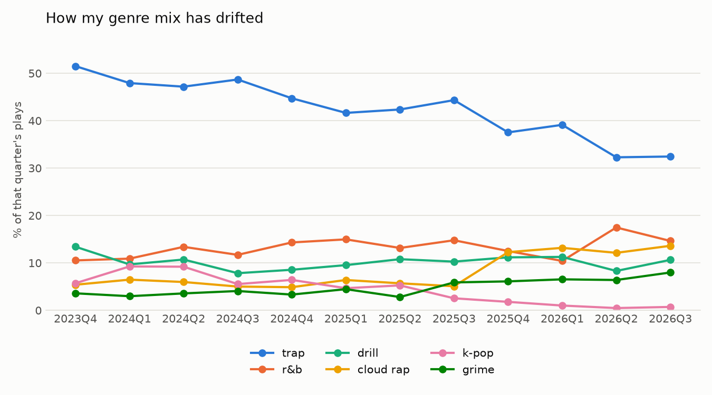
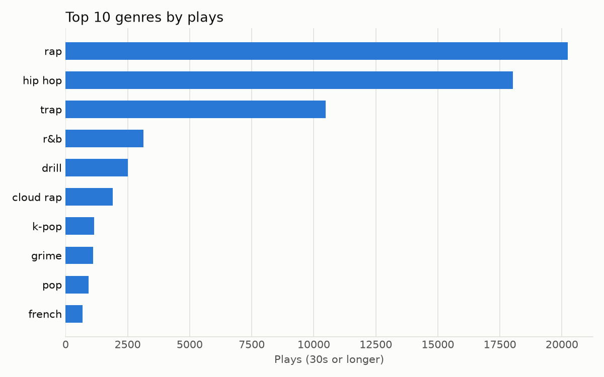

# Taste Drift

How has my music taste changed over time? This project loads my own Spotify
listening history into a relational SQLite database, tags every artist with
genres, and analyses how my genre mix has shifted quarter by quarter.



## What it found

From about 24,500 plays (30 seconds or longer) between October 2023 and
September 2026:

- **Trap is fading.** It went from roughly 51% of my plays to about 32%.
- **Cloud rap more than doubled**, from about 5% to 14%, with the jump in late 2025.
- **K-pop almost disappeared**, from about 9% in early 2024 to under 1%.
- **Grime grew** from about 3.5% to 8%.



## How it works

```
Spotify export (JSON)  ->  etl.py  ->  SQLite  ->  enrich.py (Last.fm genres)  ->  analysis.py  ->  charts
```

| File | What it does |
|------|--------------|
| `sql/schema.sql` | Six normalised tables: `artists`, `albums`, `tracks`, `streams`, `genres`, `artist_genres` |
| `src/db.py` | Creates the SQLite database from the schema |
| `src/etl.py` | Extracts music plays from the export, drops podcasts/audiobooks, loads them with get-or-create logic so artists, albums and tracks are stored once |
| `src/enrich.py` | Fetches genre tags for every artist from the Last.fm API |
| `src/analysis.py` | Prints summary tables and saves the charts in `charts/` |

### Schema

`artists -> albums -> tracks -> streams` is a chain of one-to-many
relationships, so each name is stored once and plays reference a track by ID.
Genres are many-to-many (an artist has several genres, a genre has many
artists), so they use a junction table, `artist_genres`.

## Run it yourself

1. Request your **Extended Streaming History** from Spotify (Account -> Privacy
   -> Download your data) and put the `Streaming_History_Audio_*.json` files in `data/raw/`.
2. Get a free API key at <https://www.last.fm/api/account/create> and copy
   `.env.example` to `.env`, filling in `LASTFM_API_KEY`.
3. Install and run:

```powershell
python -m venv .venv
.venv\Scripts\activate
pip install -r requirements.txt
python src/db.py
python src/etl.py
python src/enrich.py
python src/analysis.py
```

Your raw export and the database contain personal data, so `data/raw/` and
`data/processed/*.db` are gitignored.

## Decisions and limitations

- **Genres come from Last.fm, not Spotify.** Spotify's API no longer returns
  genres to new apps (the artist objects have no `genres` field), and
  MusicBrainz was missing tags for many of the artists I listen to. Last.fm's
  crowd-sourced tags covered 838 of 1,023 artists, which is 99.1% of analysed plays.
- **Genres are artist-level.** Every play inherits its artist's tags, so an
  artist's whole catalogue counts as the same genres.
- **Tags are noisy.** Last.fm spells some genres several ways, so a few are
  merged by hand (`hip-hop`/`hip hop`, `rnb`/`r&b`, `kpop`/`k-pop`). `rap` and
  `hip hop` tag almost everything, so they are left off the drift chart.
- **Plays under 30 seconds are ignored**, to filter out skips.
- **The first and last quarters are partial.** The export starts mid-October 2023
  and ends in September 2026. Values are shares, so this does not distort them.
- Spotify's audio-features endpoint (energy, valence) is deprecated for new
  apps, so this project analyses genres and artists only.

## Tech

Python, SQLite (`sqlite3`), pandas, matplotlib, requests, python-dotenv.
